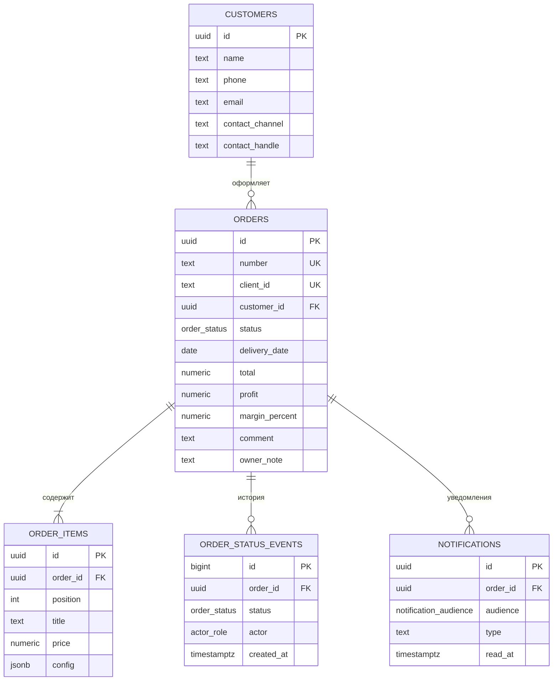

# Схема БД и план подключения

Документ описывает целевую схему PostgreSQL для «Кондитерского Рая». Сейчас
приложение работает на localStorage (`apps/extension/src/data/local`), но все
страницы уже ходят через контракт `OrderRepository`. Чтобы перейти на БД,
достаточно реализовать HTTP-адаптер и включить `VITE_DATA_SOURCE=http`.

## 1. ER-диаграмма



## 2. Перечисления

```sql
create extension if not exists pgcrypto;

create type order_status as enum ('new', 'confirmed', 'ready', 'completed', 'declined');
create type delivery_method as enum ('delivery', 'pickup');
create type actor_role as enum ('customer', 'owner', 'system');
create type notification_audience as enum ('customer', 'owner');
```

> При миграции старых данных: `processing -> confirmed`, `delivered -> completed`.

## 3. Клиенты и заказы

```sql
create table customers (
  id uuid primary key default gen_random_uuid(),
  name text not null,
  phone text not null,
  email text,
  contact_channel text check (
    contact_channel in ('telegram', 'whatsapp', 'instagram', 'vk', 'other')
  ),
  contact_handle text check (char_length(contact_handle) <= 64),
  created_at timestamptz not null default now(),
  updated_at timestamptz not null default now()
);

create unique index customers_phone_key on customers (phone);

create table orders (
  id uuid primary key default gen_random_uuid(),
  number text not null unique,
  -- id заказа из PWA: защищает от дублей при повторной отправке из офлайна
  client_id text unique,
  customer_id uuid not null references customers (id) on delete restrict,
  status order_status not null default 'new',

  delivery_method delivery_method not null,
  delivery_date date not null,
  delivery_time_slot text not null,
  delivery_address text,
  comment text check (char_length(comment) <= 500),
  owner_note text,

  subtotal numeric(10, 2) not null check (subtotal >= 0),
  delivery_fee numeric(10, 2) not null default 0 check (delivery_fee >= 0),
  total numeric(10, 2) not null check (total >= 0),

  -- снимок себестоимости на момент оформления
  items_cost numeric(10, 2) not null default 0,
  packaging_cost numeric(10, 2) not null default 0,
  delivery_cost numeric(10, 2) not null default 0,
  cost_total numeric(10, 2) not null default 0,
  profit numeric(10, 2) not null default 0,
  margin_percent numeric(5, 2) not null default 0,

  is_demo boolean not null default false,
  created_at timestamptz not null default now(),
  confirmed_at timestamptz,
  ready_at timestamptz,
  completed_at timestamptz,
  declined_at timestamptz,
  updated_at timestamptz not null default now()
);
```

Деньги хранятся в `numeric`, а не `float`: иначе копейки «плывут» на отчётах.
Дата получения — `date` (локальная дата клиента), все метки времени — `timestamptz`.

## 4. Позиции, история, уведомления, настройки

```sql
create table order_items (
  id uuid primary key default gen_random_uuid(),
  order_id uuid not null references orders (id) on delete cascade,
  position integer not null,
  title text not null,
  price numeric(10, 2) not null check (price >= 0),
  config jsonb not null,
  composition jsonb not null default '[]'::jsonb,
  unique (order_id, position)
);

create table order_status_events (
  id bigint generated always as identity primary key,
  order_id uuid not null references orders (id) on delete cascade,
  status order_status not null,
  actor actor_role not null,
  note text,
  created_at timestamptz not null default now()
);

create table notifications (
  id uuid primary key default gen_random_uuid(),
  order_id uuid not null references orders (id) on delete cascade,
  audience notification_audience not null,
  type text not null,
  title text not null,
  body text not null,
  read_at timestamptz,
  created_at timestamptz not null default now()
);

create table business_settings (
  id smallint primary key default 1 check (id = 1),
  owner_name text not null,
  owner_pin_hash text not null,
  default_cost_rate numeric(4, 3) not null default 0.350
    check (default_cost_rate between 0 and 1),
  packaging_cost_per_item numeric(10, 2) not null default 60,
  delivery_cost numeric(10, 2) not null default 150,
  updated_at timestamptz not null default now()
);
```

`config` и `composition` — `jsonb`, потому что состав торта уже описан типом
`CakeConfig` и может расширяться без миграции таблицы.

## 5. Индексы

```sql
create index orders_status_idx on orders (status);
create index orders_delivery_date_idx on orders (delivery_date);
create index orders_created_at_idx on orders (created_at desc);
create index orders_customer_idx on orders (customer_id);
create index customers_phone_idx on customers (phone);
create index status_events_order_idx on order_status_events (order_id, created_at);
create index notifications_audience_idx on notifications (audience, read_at);
```

## 6. RLS для Supabase (пример)

```sql
alter table customers enable row level security;
alter table orders enable row level security;
alter table order_items enable row level security;
alter table order_status_events enable row level security;
alter table notifications enable row level security;
alter table business_settings enable row level security;

-- Владелец: отдельная роль в JWT (выдаётся после настоящей авторизации).
create policy owner_orders_all on orders
  for all using (auth.jwt() ->> 'role' = 'owner');

-- Клиент: только свои заказы.
create policy customer_orders_select on orders
  for select using (customer_id = auth.uid());

create policy customer_items_select on order_items
  for select using (
    exists (
      select 1 from orders o
      where o.id = order_items.order_id
        and (o.customer_id = auth.uid() or auth.jwt() ->> 'role' = 'owner')
    )
  );

create policy customer_notifications_select on notifications
  for select using (
    exists (
      select 1 from orders o
      where o.id = notifications.order_id and o.customer_id = auth.uid()
    )
  );
```

PIN владельца в `business_settings` — только хэш (`bcrypt`/`argon2`); демо-PIN
из `business.json` в прод не переносится.

## 7. Миграция localStorage → PostgreSQL

1. Выгрузить ключи `candys-paradise.orders.v1` и
   `candys-paradise.notifications.v1` из браузера (экспорт JSON).
2. Прогнать через `migrateOrders()` — старые статусы и комментарий из
   `delivery.comment` поднимутся автоматически.
3. Для каждого заказа вызвать `POST /api/orders`, передав `client_id = order.id`.
   API делает `insert ... on conflict (client_id) do nothing` — повторная
   отправка не создаст дубль.
4. Позиции и историю статусов записать в `order_items` / `order_status_events`.
5. Сверить количество заказов, суммы и прибыль до/после.
6. Включить `VITE_DATA_SOURCE=http` и указать `VITE_ORDER_API_URL`.

## 8. Будущие эндпоинты

| Метод | Путь | Назначение |
|---|---|---|
| `POST` | `/api/orders` | Создать заказ (идемпотентно по `client_id`) |
| `GET` | `/api/orders` | Список для владельца: фильтры по статусу/дате |
| `PATCH` | `/api/orders/:id/status` | Сменить статус, записать событие и уведомление |
| `PATCH` | `/api/orders/:id/note` | Заметка владельца |
| `GET` | `/api/notifications` | Уведомления текущей роли |
| `PATCH` | `/api/notifications/:id/read` | Отметить прочитанным |
| `POST` | `/api/owner/session` | Вход владельца, выдача JWT |

Уведомления клиенту вне браузера (Telegram / email / push) — следующий этап;
он подключается в `notificationsService` и не меняет контракт репозитория.
